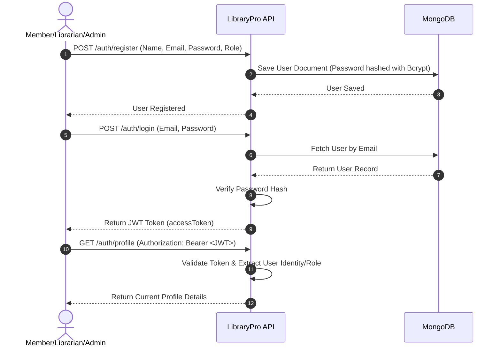
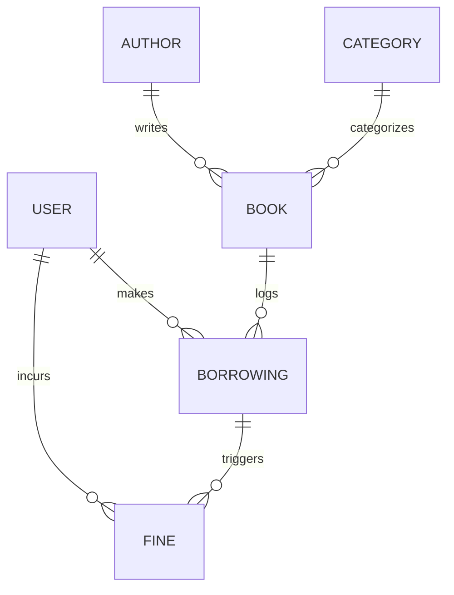

# LibraryPro API

[](https://nestjs.com/)
[](https://www.typescriptlang.org/)
[](https://www.mongodb.com/)
[](https://swagger.io/)
[](https://www.docker.com/)
[](https://opensource.org/licenses/MIT)

**LibraryPro API** is a production-ready, fellowship-grade Library Management REST API engineered using NestJS, MongoDB, and TypeScript. Designed with clean modular architecture, security best practices, and granular Role-Based Access Control (RBAC), it provides a robust infrastructure to manage libraries, catalogue records, handle book acquisitions, track real-time borrowing logs, automatically calculate overdue fines, and display dynamic library dashboards. 

---

## Features

- [x] **JWT Authentication**: Secure user registration, authentication, profile updates, and password changes.
- [x] **Role-Based Authorization (RBAC)**: Granular access control policies across three roles: `ADMIN`, `LIBRARIAN`, and `MEMBER`.
- [x] **User Management**: Profile updates and password changes securely hashed using Bcrypt.
- [x] **Book Management**: Dynamic inventory catalog with custom slug generation, ISBN validation, category/author linkages, and availability status.
- [x] **Author Management**: Records authors including biographies, nationalities, and portfolios.
- [x] **Category Management**: Hierarchical categorization with slugified search indexes.
- [x] **Borrow & Return Books**: Thread-safe transactional borrowing logs that prevent duplicate active checkouts and dynamically adjust inventory metrics.
- [x] **Fine Management**: Scheduled and triggered fee assessments with daily overdue parameters configurable from `.env`, complete with Librarians payment confirmations and Admin waivers.
- [x] **Dashboard Statistics**: Aggregate counters tracking database volumes, current checkouts, outstanding payments, most popular books, and active borrowing histories.
- [x] **Pagination & Search**: Extensible query pipeline handling partial search matches, dynamic multi-attribute filters, and custom sorting directions.
- [x] **MongoDB Integration**: Schema validation, compound indexing, and population pipelines handled through Mongoose.
- [x] **Swagger Documentation**: Complete interactive OpenAPI spec decorated with DTO examples and role permissions.
- [x] **Docker Support**: Containerized environment orchestration utilizing Docker Compose with integrated services health checking.
- [x] **Global Validation**: Automated Request DTO sanitization and validation using `class-validator`.
- [x] **Error Handling**: Custom exception mapping standardizing error schemas.
- [x] **Health Check API**: Live system diagnostics assessing backend operations and MongoDB status.

---

## Tech Stack

| Technology | Role | Version |
| :--- | :--- | :--- |
| **NestJS** | Core Framework | `v11.x` |
| **TypeScript** | Programming Language | `v5.x` |
| **MongoDB** | Primary NoSQL Database | `v8.x` |
| **Mongoose** | MongoDB Object Modeling ODM | `v9.x` |
| **JWT** | Authentication Token Protocol | Standard |
| **Passport** | Authentication Middleware | Standard |
| **Bcryptjs** | Safe Password Hashing | Standard |
| **Swagger** | API Documentation Spec | OpenAPI 3 |
| **Docker** | Containerization & Orchestration | `v20+` |
| **Jest** | Automated Testing Suite | `v30.x` |

---

## Project Structure

```text
src/
├── main.ts                     # Application bootstrap script, middlewares, and Swagger setup
├── app.module.ts               # Roots all core modules, database configs, and global throttlers
├── common/                     # Shared cross-cutting components
│   ├── constants/              # Status enums (BookStatus, BorrowingStatus, FineStatus, UserRole)
│   ├── decorators/             # Custom annotations (@CurrentUser, @Roles, @Public)
│   ├── dto/                    # Global query schemas (PaginationQueryDto)
│   ├── filters/                # Global exceptions interceptors (HttpExceptionFilter)
│   ├── guards/                 # Access policies (JwtAuthGuard, RolesGuard)
│   ├── interceptors/           # Standardized response wrappers (TransformInterceptor)
│   └── utils/                  # Cryptographic and slugification helpers
├── config/                     # Environment loading validation schema (env.config.ts)
└── modules/                    # Encapsulated feature domains
    ├── auth/                   # Registration, session login, profile actions
    ├── users/                  # User accounts persistence layer
    ├── books/                  # Book catalogues, search, updates
    ├── authors/                # Author directories
    ├── categories/             # Book category hierarchies
    ├── borrowings/             # Check-out, check-in, and status lifecycle logs
    ├── fines/                  # Fee calculations, payments, and waivers
    ├── dashboard/              # Dynamic library metrics aggregations
    └── health/                 # Diagnostics endpoint checker
```

---

## Installation

### Prerequisites
- Node.js (v22+)
- pnpm (v10+)
- MongoDB running locally on port `27017` (if not running containerized)

### Step-by-Step Setup
1. **Clone the Repository**
   ```bash
   git clone https://github.com/yourusername/libraryapi.git
   cd libraryapi
   ```

2. **Install Dependencies**
   ```bash
   pnpm install
   ```

3. **Configure Environment Variables**
   ```bash
   cp .env.example .env
   ```
   Open the `.env` file and adjust settings as required for your local database.

4. **Start MongoDB Service**
   Ensure your local MongoDB daemon is running:
   ```bash
   # On macOS
   brew services start mongodb-community
   # On Ubuntu/Linux
   sudo systemctl start mongod
   ```

5. **Start the Application**
   ```bash
   pnpm start:dev
   ```

---

## Environment Variables

The application uses standard `.env` configuration. A complete schema breakdown is provided below:

```ini
# Application Config
PORT=3000
NODE_ENV=development

# Database Config
MONGODB_URI=mongodb://localhost:27017/librarypro

# Auth Config
JWT_SECRET=super-secret-key-change-in-production
JWT_EXPIRATION=1d

# Library Policy Config
FINE_RATE_PER_DAY=1.5

# Rate Limiting Config
THROTTLER_TTL=60000
THROTTLER_LIMIT=100
```

| Variable Name | Purpose | Example Value |
| :--- | :--- | :--- |
| `PORT` | Listening port for the HTTP server | `3000` |
| `NODE_ENV` | Mode of runtime execution environment | `development` / `production` |
| `MONGODB_URI` | Full connection URI to the MongoDB instance | `mongodb://localhost:27017/librarypro` |
| `JWT_SECRET` | Secret key utilized to sign JWT payload signature | `some-secret` |
| `JWT_EXPIRATION` | Lifespan duration of generated access tokens | `1d` / `3600` |
| `FINE_RATE_PER_DAY` | Fine charge amount currency units per day overdue | `1.5` |
| `THROTTLER_TTL` | Rate limit window duration (milliseconds) | `60000` |
| `THROTTLER_LIMIT` | Maximum HTTP requests allowed per client in TTL window | `100` |

---

## Running the Project

Manage application execution using the following script tasks:

```bash
# Build the TypeScript project
pnpm run build

# Run in Development mode
pnpm run start:dev

# Run in Production mode
pnpm run start:prod

# Run code formatter
pnpm run format

# Run linter
pnpm run lint

# Run unit tests
pnpm run test

# Run e2e integration tests
pnpm run test:e2e
```

---

## API Documentation

Interactive endpoint documentation is generated automatically using Swagger (OpenAPI 3.0 specification).

- **Swagger UI Endpoint URL**: `http://localhost:3000/api/docs`
- **JWT Authorization Setup**: 
  1. Authenticate by making a call to `POST /auth/login`.
  2. Copy the `accessToken` string from the JSON response.
  3. Click the **Authorize** button at the top-right of the Swagger page.
  4. Paste the copied token and click **Authorize**. Subsequent requests will include the bearer token in the HTTP Authorization headers.

---

## Authentication Flow



---

## Database Design

The data layer consists of six collections modeled via Mongoose. Schema connections are established through reference fields:



### Collections Breakdown
1. **Users**: Stores profile credentials, emails (unique indexed), and system role permissions.
2. **Authors**: Details biographies and nationalities linked to written works.
3. **Categories**: Segments catalogs using unique slugified names.
4. **Books**: Indexes title, ISBN, and tags. Tracks stock details (`totalCopies` & `availableCopies`).
5. **Borrowings**: Registers borrowing transactions. Links user accounts to book references, tracking dates and statuses.
6. **Fines**: Monitors unpaid balances, correlating overdue borrowings directly with their respective users.

---

## API Modules

| Module Name | Path Prefix | Operations | Role Requirements |
| :--- | :--- | :--- | :--- |
| **Auth** | `/auth` | Register, Login, Get Profile, Update Profile, Change Password | Public (Login/Register), Protected (Profile actions) |
| **Categories** | `/categories` | Create, Read All, Read One, Update, Delete | Public (Read), Admin/Librarian (Write), Admin (Delete) |
| **Authors** | `/authors` | Create, Read All, Read One, Update, Delete | Public (Read), Admin/Librarian (Write), Admin (Delete) |
| **Books** | `/books` | Create, Read All (Filter/Search/Sort), Read One, Update, Delete | Public (Read), Admin/Librarian (Write), Admin (Delete) |
| **Borrowings** | `/borrowings` | Borrow Book, Return Book, Read All, Read My, Read Overdue | Member/Librarian/Admin (Borrow/Read My), Librarian/Admin (Return/Read All/Read Overdue) |
| **Fines** | `/fines` | Scan/Generate, Read All, Read My, Pay Fine, Waive Fine | Member/Librarian/Admin (Read My), Librarian/Admin (Generate/Read All/Pay), Admin (Waive) |
| **Dashboard** | `/dashboard` | Retrieve System metrics counters | Admin/Librarian |
| **Health** | `/health` | Live database ready-state check | Public |

---

## Security Features

- **JWT Authentication**: Protected route access utilizing digital JWT signatures to isolate session data securely.
- **granular Role Guarding**: Authorizes routes programmatically by matching authenticated identity payload roles against route access definitions (`ADMIN`, `LIBRARIAN`, `MEMBER`).
- **Cryptographic Hashing**: Hashes passwords using 10 rounds of salt generation via `bcryptjs`.
- **Helmet Middleware**: Configures HTTP headers to protect against clickjacking, cross-site scripting, and sniffing.
- **Request Rate Limiting**: Intercepts requests globally via a Throttler window configuration to prevent brute-force attacks.
- **Validation Pipe**: Sanitizes request bodies against DTO structures using `class-validator`, ignoring non-whitelisted attributes.

---

## Error Handling

Standardized API responses are returned globally for errors using a custom `HttpExceptionFilter`. All error payloads adhere to the following schema:

```json
{
  "success": false,
  "statusCode": 400,
  "message": "Validation failed",
  "errors": [
    "email must be an email",
    "password must be longer than or equal to 6 characters"
  ],
  "path": "/auth/register",
  "timestamp": "2026-07-03T11:29:09.000Z"
}
```

---

## Testing

The codebase implements automated testing with Jest. Mocked repositories isolate dependency services in unit tests, while custom integration fixtures are provided for end-to-end checks.

```bash
# Run unit tests
pnpm run test

# Run e2e tests
pnpm run test:e2e
```

---

## Docker

Standard configuration is packaged inside Docker specifications to run containerized.

### Build and Run with Docker Compose
To run both the application and the MongoDB database automatically:
```bash
docker-compose up --build
```
This boots:
1. **mongodb**: A healthy MongoDB daemon exposed on host port `27017`.
2. **app**: The NestJS server waiting for the db health check before binding on port `3000`.

To stop the services:
```bash
docker-compose down
```

---

## Future Improvements

- [ ] **Email Verification**: Implement account verification protocols.
- [ ] **Password Reset**: Setup mail servers for recovery tokens.
- [ ] **QR Code Support**: Add barcode/QR scanner integration for physical checkouts.
- [ ] **Book Reservations**: Allow members to reserve copies currently out of stock.
- [ ] **Notifications**: Real-time push updates notifying members of upcoming return dates.
- [ ] **Audit Logging**: Structured logger recording database changes.
- [ ] **Elasticsearch Search**: Integrate search engines for indexing massive catalogs.
- [ ] **Redis Caching**: Optimize response times using memory cache backends.

---

## Screenshots

Below are typical workflow layouts and representations of the API interfaces:

### Swagger UI API Interface


### MongoDB Database Collections


### Project Folder Directory Tree
```text
.
├── src/
│   ├── common/
│   ├── config/
│   ├── database/
│   └── modules/
├── test/
├── Dockerfile
├── docker-compose.yml
└── package.json
```

---

## Learning Outcomes

Engineering the **LibraryPro API** provided hands-on experience applying core backend paradigms using NestJS:
- **Modular Design**: Scaffolding features using decoupled modules, providers, and controller definitions.
- **Dependency Injection**: Managing application lifetimes using NestJS dependency resolution.
- **Request Parsing Pipes**: Handling dynamic transformations and payload validations.
- **Guards Pipeline**: Structuring authentication strategies (Passport JWT) and RBAC.
- **Data Modeling**: Designing indexes, population refs, and compound schemas with Mongoose.
- **API Spec Management**: Exporting swagger metadata annotations dynamically.
- **Containerization**: Composing microservice networks with Docker Compose.

---

## Author

- **Name**: Muhammad Asad Ullah
- **GitHub**: https://github.com/Asad2512-dev
- **LinkedIn**: https://www.linkedin.com/in/asadullah2512/
- **Portfolio**: https://codebyasad.com

---

## License

This project is licensed under the terms of the [MIT License](https://opensource.org/licenses/MIT).
# library-api-nestjs
